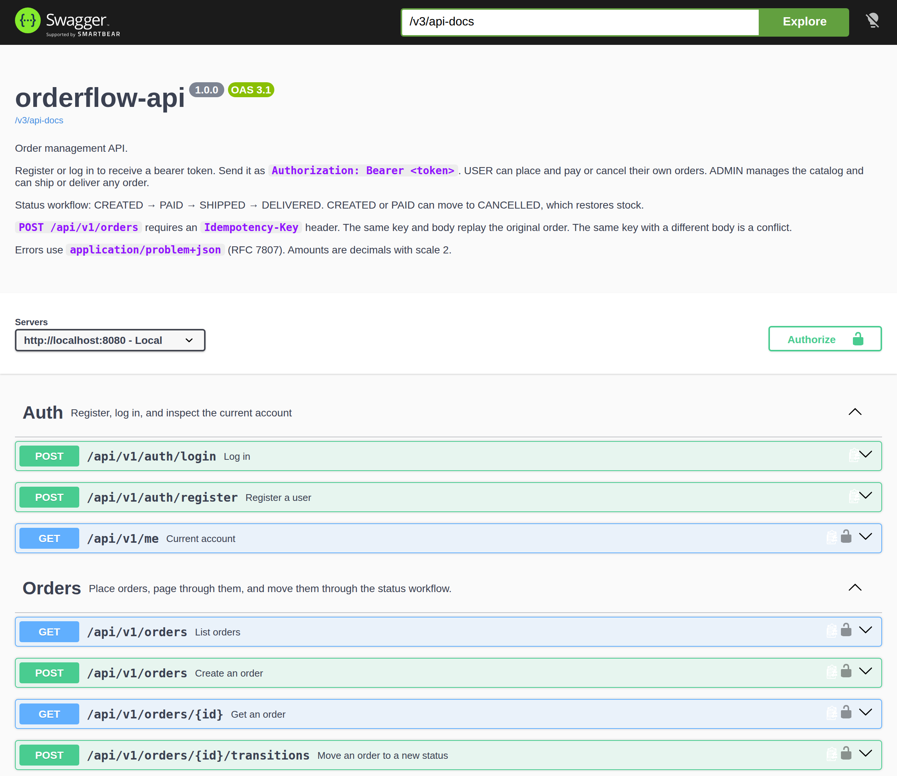
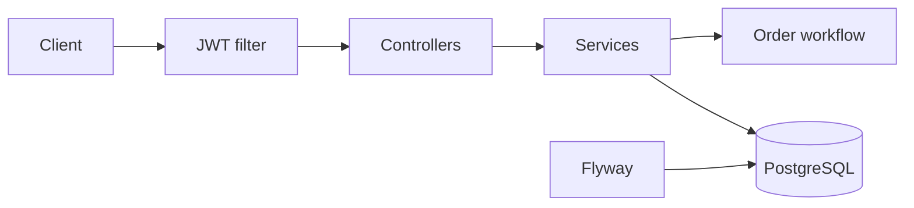
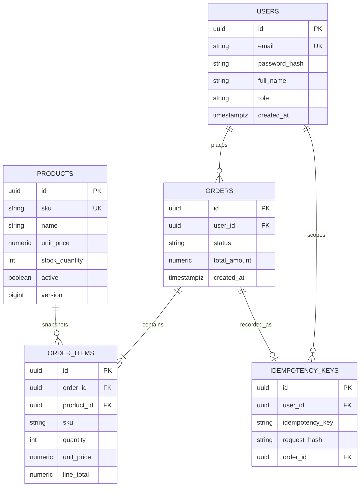
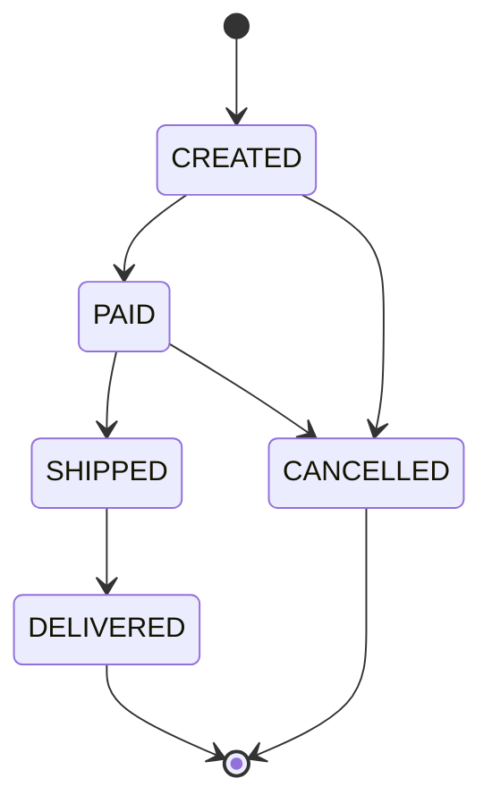

# orderflow-api

Order management REST API on Spring Boot 3 and Java 21. JWT auth with USER and ADMIN roles, a validated order status workflow, idempotent creates, PostgreSQL with Flyway, and RFC 7807 errors.

**Live docs:** [https://naveecode.github.io/orderflow-api/](https://naveecode.github.io/orderflow-api/) · [API reference](https://naveecode.github.io/orderflow-api/api/)



[CI](https://github.com/naveecode/orderflow-api/actions/workflows/ci.yml) runs `./mvnw -B verify`.

## Stack

- Java 21, Spring Boot 3.5, Spring Security, Spring Data JPA
- PostgreSQL 16, Flyway, Hibernate schema validation
- JJWT (HS256) access tokens
- springdoc OpenAPI and Swagger UI
- JUnit 5, AssertJ, Testcontainers
- Docker Compose and a multi-stage image with a readiness healthcheck

## Architecture

Stateless HTTP API. A JWT filter authenticates the caller, controllers stay thin, and services own transactions. Order placement plans lines against the catalog, decrements stock, and records an idempotency key in the same transaction. Status changes go through one workflow so illegal moves never reach the database.



- **Auth.** Register creates a USER. Login returns a bearer token. ADMIN is seeded for catalog and fulfillment.
- **Catalog.** Products carry price, stock, and a `@Version` column. Concurrent stock updates fail the loser with a conflict instead of overselling.
- **Orders.** `Idempotency-Key` is unique per user. The same key and body replay the original order. The same key with a different body is a conflict. Cancelling a CREATED or PAID order restores stock.
- **Errors.** `@ControllerAdvice` writes `application/problem+json`. Type URIs point at the [problem catalog](https://naveecode.github.io/orderflow-api/#problems).

## Data model



Line items snapshot SKU, name, and unit price so later catalog edits do not rewrite history.

## Status workflow



| From | To | Who |
| --- | --- | --- |
| CREATED | PAID, CANCELLED | Owner or ADMIN |
| PAID | SHIPPED | ADMIN |
| PAID | CANCELLED | Owner or ADMIN |
| SHIPPED | DELIVERED | ADMIN |

DELIVERED and CANCELLED are terminal. Any other move returns `409 INVALID_TRANSITION`. A legal move the role cannot perform returns `403 FORBIDDEN`.

## Run

Docker Compose starts Postgres and the API:

```bash
docker compose up --build
```

The app listens on [http://localhost:8080](http://localhost:8080). Readiness is `GET /actuator/health/readiness`. Swagger UI is [http://localhost:8080/swagger-ui.html](http://localhost:8080/swagger-ui.html).

To run from the Maven wrapper against a database only:

```bash
docker compose up postgres -d
./mvnw spring-boot:run
```

Set `JWT_SECRET` to at least 32 bytes outside local demos. See `.env.example`.

## Demo data

Flyway seeds an admin and three products. The password is for local demos.

| Email | Password | Role |
| --- | --- | --- |
| `admin@orderflow.dev` | `ChangeMe123!` | ADMIN |

| SKU | Product | Price | Id |
| --- | --- | --- | --- |
| OF-KBD-01 | Mechanical Keyboard | 129.00 | `22222222-2222-2222-2222-222222222201` |
| OF-MSE-01 | Wireless Mouse | 49.00 | `22222222-2222-2222-2222-222222222202` |
| OF-HUB-01 | USB-C Hub | 79.50 | `22222222-2222-2222-2222-222222222203` |

## Try it

Register, log in, place one keyboard order, then send the same request again. This transcript is from a local server on 2026-10-18. Use the access token from login as `$TOKEN`.

```bash
curl -sS -X POST http://localhost:8080/api/v1/auth/register \
  -H 'Content-Type: application/json' \
  -d '{"email":"ada.tryit@example.com","password":"Password123","fullName":"Ada Lovelace"}'

curl -sS -X POST http://localhost:8080/api/v1/auth/login \
  -H 'Content-Type: application/json' \
  -d '{"email":"ada.tryit@example.com","password":"Password123"}'

curl -sS -X POST http://localhost:8080/api/v1/orders \
  -H "Authorization: Bearer $TOKEN" \
  -H 'Content-Type: application/json' \
  -H 'Idempotency-Key: 6f1e1b5a-2c3d-4e5f-8a9b-0c1d2e3f4a5b' \
  -d '{"items":[{"productId":"22222222-2222-2222-2222-222222222201","quantity":1}]}'

curl -sS -D - -X POST http://localhost:8080/api/v1/orders \
  -H "Authorization: Bearer $TOKEN" \
  -H 'Content-Type: application/json' \
  -H 'Idempotency-Key: 6f1e1b5a-2c3d-4e5f-8a9b-0c1d2e3f4a5b' \
  -d '{"items":[{"productId":"22222222-2222-2222-2222-222222222201","quantity":1}]}'
```

Register returned `201`. Login returned `200` with `tokenType` `Bearer` and `expiresIn` `7200` (token omitted). The first create returned `201` and `Location: /api/v1/orders/56a0fe09-266b-4539-811e-b9822cbf4696`. The replay returned `200` and `Idempotency-Replayed: true` with the same order:

```json
{
  "id": "56a0fe09-266b-4539-811e-b9822cbf4696",
  "userId": "f04275f2-47b7-496f-b3e7-a078cf1f0da8",
  "status": "CREATED",
  "totalAmount": 129.00,
  "items": [
    {
      "productId": "22222222-2222-2222-2222-222222222201",
      "sku": "OF-KBD-01",
      "productName": "Mechanical Keyboard",
      "quantity": 1,
      "unitPrice": 129.00,
      "lineTotal": 129.00
    }
  ],
  "createdAt": "2026-10-18T13:42:30.062749Z",
  "updatedAt": "2026-10-18T13:42:30.062749Z"
}
```

## API examples

Register and keep the token:

```bash
curl -sS -X POST http://localhost:8080/api/v1/auth/register \
  -H 'Content-Type: application/json' \
  -d '{"email":"ada@example.com","password":"Password123","fullName":"Ada Lovelace"}'
```

Log in as the seeded admin:

```bash
curl -sS -X POST http://localhost:8080/api/v1/auth/login \
  -H 'Content-Type: application/json' \
  -d '{"email":"admin@orderflow.dev","password":"ChangeMe123!"}'
```

Place an order. Repeat the same key and body to replay it (`200` and `Idempotency-Replayed: true`). A different body with that key returns `409`.

```bash
curl -sS -X POST http://localhost:8080/api/v1/orders \
  -H "Authorization: Bearer $TOKEN" \
  -H 'Content-Type: application/json' \
  -H 'Idempotency-Key: 6f1e1b5a-2c3d-4e5f-8a9b-0c1d2e3f4a5b' \
  -d '{"items":[{"productId":"22222222-2222-2222-2222-222222222201","quantity":1}]}'
```

Pay, then ship as an admin:

```bash
curl -sS -X POST "http://localhost:8080/api/v1/orders/$ORDER_ID/transitions" \
  -H "Authorization: Bearer $TOKEN" \
  -H 'Content-Type: application/json' \
  -d '{"status":"PAID"}'
```

List a page of your orders:

```bash
curl -sS "http://localhost:8080/api/v1/orders?status=PAID&page=0&size=20&sort=createdAt,desc" \
  -H "Authorization: Bearer $TOKEN"
```

`createdFrom` is inclusive and `createdTo` is exclusive. Users only see their own orders. Admins can pass `userId`. Product reads are public. Product writes require ADMIN.

Amounts are decimals with scale 2. Unknown JSON properties are rejected.

## Tests

```bash
./mvnw -B verify
```

Unit tests cover the status graph, line pricing, the idempotency fingerprint, page sorting, and JWT issue/expiry. `OrderflowApiTest` boots the API against PostgreSQL in Testcontainers and exercises auth, catalog rules, idempotent creates, filtering, stock restore, concurrent last-unit orders, and problem responses. Docker is required for that test.

## Configuration

| Variable | Default | Purpose |
| --- | --- | --- |
| `SPRING_DATASOURCE_URL` | `jdbc:postgresql://localhost:5432/orderflow` | JDBC URL |
| `SPRING_DATASOURCE_USERNAME` | `orderflow` | Database user |
| `SPRING_DATASOURCE_PASSWORD` | `orderflow` | Database password |
| `JWT_SECRET` | dev-only value in `application.yml` | HS256 secret, 32 bytes minimum |
| `JWT_EXPIRATION` | `2h` | Access token lifetime |
| `PORT` | `8080` | HTTP port |

## Layout

```
src/main/java/dev/naveencode/orderflow
  config/        security filter chain, OpenAPI
  security/      JWT issue and parse
  user/          register, login
  product/       catalog and stock
  order/         workflow, placement, queries
  idempotency/   key storage and request hash
  error/         RFC 7807 responses
src/main/resources/db/migration
docs/            GitHub Pages landing page and Redoc shell
```
